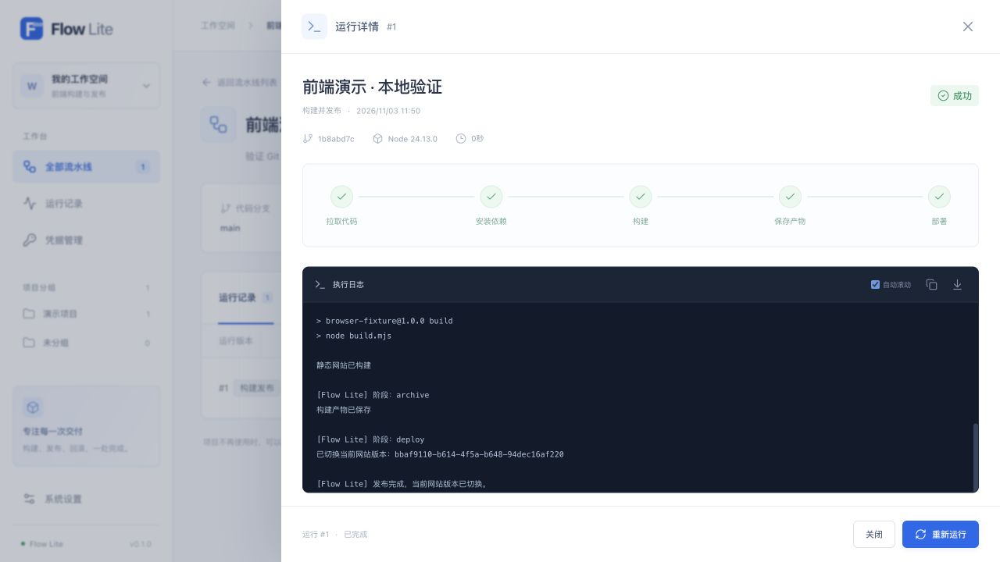

# Flow Lite

一个可以部署在自己服务器上的轻量流水线面板，支持 Node.js 静态网站构建发布，以及 PHP / 自定义命令执行。

[](https://github.com/lorvanto/flow-lite/actions/workflows/ci.yml)
[](LICENSE)



## 主要功能

- Node.js 项目：拉取 Git 代码、安装依赖、构建和保存静态产物；支持 Node.js 14、18、22、24、26、自定义版本和仓库版本文件识别。
- 本机或 SSH 发布：独立版本目录、原子切换，以及使用历史产物回滚。
- PHP / 命令发布：在已有项目目录中执行多行 Shell 命令，适合 Git 更新、Composer 安装和缓存清理。
- SSH 私钥或密码认证，支持为代码仓库和部署目标分别选择凭据。
- 项目分组、串行任务队列、实时日志、运行历史、取消和重新运行。

平台面向可信管理员和自有仓库。自定义命令会直接修改目标目录，取消和重试不会撤销已完成的操作；仅 Node.js 静态产物支持版本回滚。当前没有 Webhook、拖拽编排、多用户权限或 Node.js 常驻服务托管。

## 快速启动

平台需要 **Node.js 24+**。Node.js 容器构建另需 Git、Docker 和 `tar`；SSH 功能需要 OpenSSH 客户端。只执行 PHP / 自定义命令时不需要 Docker，PHP、Composer 等由执行目标提供。

```sh
git clone https://github.com/lorvanto/flow-lite.git
cd flow-lite
npm ci
cp .env.example .env
npm run dev
```

打开 [本地开发页面](http://127.0.0.1:5173)。首次启动后读取 `data/setup-token`，在页面中创建管理员；初始化令牌与实际数据目录不要提交到 Git。

生产环境先执行 `npm run build`，再分别启动 `npm start` 与 `npm run worker`。长期运行、HTTPS 和目录权限配置见 [部署指南](docs/deployment.md)。

## 目录结构

```text
server/
  index.mjs        API 入口
  worker.mjs       串行任务执行器入口
  app.mjs          HTTP API 与认证
  config.mjs       平台配置
  lib/             校验、加密、日志和进程工具
  services/        SQLite 存储与静态文件服务
  runners/         Node.js 构建、命令执行和 SSH 认证
web/src/
  components/      表单、运行详情和通用界面组件
  composables/     SSE 日志等组合逻辑
  lib/             API 客户端与展示工具
tests/             自动化测试
scripts/           本地开发与检查脚本
deploy/
  systemd/         Linux 服务样例
  nginx/           HTTPS 反代和静态站点样例
  pm2/             PM2 进程配置
docs/              使用、配置、部署和运维文档
```

## 文档

- [配置说明](docs/configuration.md)：环境变量、构建版本、资源上限和本地调试。
- [使用指南](docs/usage.md)：Node.js 流水线、PHP / 命令发布、SSH 凭据和重试回滚。
- [部署指南](docs/deployment.md)：systemd / PM2、Nginx、HTTPS 和已有宝塔环境。
- [运维指南](docs/operations.md)：升级、数据备份、日志、恢复和常见问题。
- [架构说明](docs/architecture.md)：API、worker、SQLite 与各执行模式的边界。

```sh
npm run verify
```

贡献流程见 [CONTRIBUTING.md](CONTRIBUTING.md)，安全问题见 [SECURITY.md](SECURITY.md)。

本项目按 [MIT License](LICENSE) 开源。项目地址：[lorvanto/flow-lite](https://github.com/lorvanto/flow-lite)。
