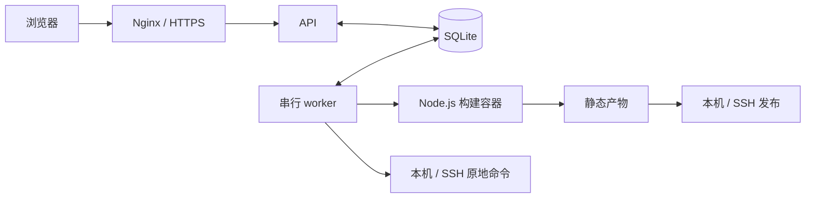

# 架构说明

Flow Lite 由 Vue 页面、Node.js API 和独立 worker 组成，面向一台 Linux 服务器上的轻量项目发布。SQLite 和本机文件系统保存状态，不需要 Redis、MySQL 或额外队列服务。

## API 与任务队列

`server/index.mjs` 启动 API，负责管理员认证、项目配置、SSH 凭据、任务入队、运行状态和日志访问。`server/worker.mjs` 是独立进程，读取同一个数据目录中的 SQLite 队列。

每个任务保存加密的配置快照，排队后的配置不会随项目后续编辑而改变。worker 使用独占租约和心跳维护队列所有权，同时只执行一个任务；API 和 worker 各运行一个实例。

运行记录区分排队、执行、成功、失败和取消。取消请求在数据库事务内根据最新状态处理；执行器重启时将中断任务标记为失败，保留排队任务，不自动重复已开始的操作。

## Node.js 构建与静态发布

构建流程为检出 Git commit、安装依赖、构建、检查并归档静态产物、发布。平台 Node.js 24+ 与项目构建版本独立，项目版本通过容器镜像选择。显式开启的 host 模式用于可信代码调试，使用平台实际 Node.js，不自动切换运行时。

Docker 容器只挂载对应工作目录和项目缓存，不挂载 Docker socket。默认 **4 CPU / 8 GB** 上限仅约束构建容器；任务仍串行，限额不代表资源预留。容器资源配置不会限制 SSH 目标机或 PHP / 命令模式。

归档产物是平台保存的独立目录；发布目标使用 `releases/<运行 ID>` 和 `current` 符号链接。文件准备完成后才切换当前版本。本机和 SSH 发布遵循相同布局，静态 Web 服务读取 `current`。

重试使用原任务已记录的 commit 与配置；回滚直接发布保留的成功产物。修改项目类型或发布目标时清空当前版本标记，并阻止旧任务跨类型或目标重试。回滚只覆盖静态文件版本，不恢复数据库或外部服务。

## SSH 与命令模式

共享 SSH 认证模块支持私钥和密码。凭据使用 AES-256-GCM 加密保存；执行时在任务私有目录准备必要文件，并在结束后清理。密码经 ASKPASS 文件交给 OpenSSH，不放进进程参数或环境变量值。主机公钥始终严格验证。

Node.js 的 Git 凭据与部署凭据分别选择。PHP / 命令模式使用目标账号直接运行 `sh -e`，工作目录必须已存在；目标机上的 Git 身份认证由该账号自行配置，不会自动获得平台用于登录服务器的凭据。

命令模式没有构建容器、静态归档或自动回滚。已经完成的文件和数据库操作不会因失败、取消或重试而撤销。远程进程组和取消后的第二次 SSH 连接用于尽力终止任务；网络故障时仍需要检查目标机实际状态。

## 存储、日志和备份

`server/services` 提供 SQLite 存储与静态页面服务，`server/lib` 包含校验、加密、日志和进程工具，`server/runners` 实现构建、命令与 SSH 认证。

`FLOW_DATA_DIR` 保存数据库、`master.key`、初始化令牌、日志、产物、工作目录和缓存。项目环境变量、凭据和任务快照均加密保存；日志对已知敏感原始值脱敏，单次日志大小和历史产物保留数量有上限。

停服务后完整备份数据目录和 `.env`。**数据库与 `master.key` 必须成套保存和恢复**，否则无法解密既有配置与凭据。数据目录、实际环境变量、私钥、密码和生产部署材料不属于公开源码。
